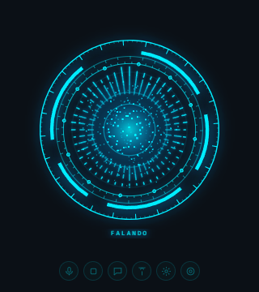
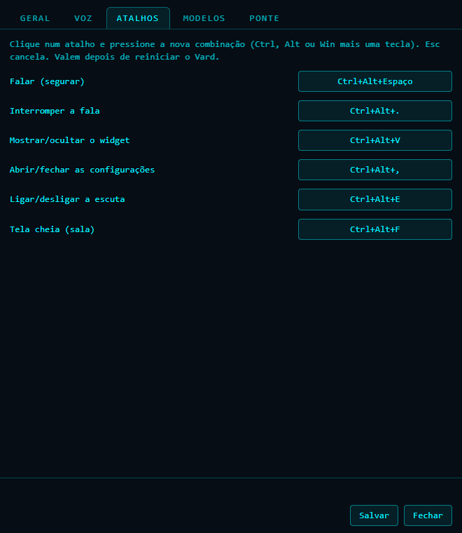
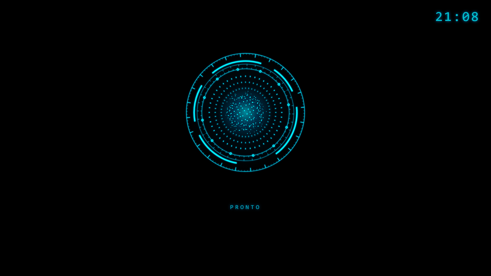

# Vard

[Read in English](README.en.md) · [Repositório](https://github.com/pauloroos/project-vard)

Vard é uma interface de voz local (widget flutuante) para assistentes; o primeiro conector é o [OpenJarvis](https://github.com/open-jarvis/OpenJarvis). Feito com Tauri 2. Uma janela transparente e sem moldura, sempre no topo, com um núcleo ciano que reage à sua voz: você fala, ele transcreve, o OpenJarvis responde e a resposta sai em voz alta.

 

Projeto independente, sem vínculo com o OpenJarvis nem com a Stanford.

## O que ele faz

- Escuta pelo microfone (detecção de voz automática) ou por push-to-talk com atalho global.
- Chama o assistente pelo nome ("Vard, que horas são"); com push-to-talk o nome é dispensado.
- Transcreve, pergunta e sintetiza a resposta no próprio OpenJarvis (`/v1/speech/transcribe`, `/v1/chat/completions`, `/v1/speech/synthesize`).
- Ícone na bandeja, painel de configurações em janela própria (abas Geral, Voz, Atalhos, Modelos, Sistema e Atualização), início opcional com o Windows.
- Três tamanhos (ou o lado em pixels, de 160 a 800) e um modo compacto que deixa só o holograma.
- Tela cheia ("sala") num monitor à escolha: vórtice grande, o que você disse, a resposta em letra grande e um relógio.
- Escolha do modelo entre os que o OpenJarvis expõe.
- Modo conversa: depois de uma resposta, continua ouvindo sem o nome por 20 s (ajustável); "pode parar de me ouvir" ou "vou entrar em reunião" mutam o microfone até você reativar.
- Voz à escolha: a voz própria (XTTS, com a lista de vozes do serviço), a do OpenJarvis (Kokoro) ou, se você quiser e com a sua chave, ElevenLabs e Gemini TTS; botão Ouvir com uma frase de amostra.
- Modo invisível: o widget some e só aparece enquanto a conversa dura.
- A barra de botões abre do lado oposto à borda do monitor (em cima quando o widget está embaixo).
- Aba Atualização: consulta a release mais nova no GitHub só quando você pede e instala dali.
- Botão **Texto** abre a interface gráfica de texto do OpenJarvis.
- Opcional: a ponte do Vard (setup privado do autor, `rdl-vard`) dá olhos na tela e modo jogo. Sem ela tudo funciona igual, veja [docs/ponte-do-vard.md](docs/ponte-do-vard.md).
- Opcional: uma voz própria (qualquer motor de voz local que siga um contrato simples) fala a resposta frase a frase, começando antes de a resposta inteira estar sintetizada. Veja [Voz própria](#voz-própria-opcional).

## Requisitos

- Windows 10 ou 11 (64 bits) com o WebView2, que já vem no Windows 11.
- OpenJarvis rodando em `http://127.0.0.1:8000` **com a fala ligada**: veja [docs/ligar-a-fala.md](docs/ligar-a-fala.md). Sem a fala o HUD abre, mas fica avisando que não consegue ouvir nem falar.
- Um microfone.
- Para o botão **Texto**: a interface gráfica do OpenJarvis (`jarvis gui`), em `http://127.0.0.1:5173`. Precisa de Node.js e do checkout do OpenJarvis.

## Instalar

Baixe o instalador na página de releases e rode um dos dois:

- `Vard_0.9.2_x64-setup.exe` (NSIS): instala só para o seu usuário, sem pedir administrador. Silencioso: `Vard_0.9.2_x64-setup.exe /S`. Fica em `%LOCALAPPDATA%\Vard\`.
- `Vard_0.9.2_x64_en-US.msi` (WiX): instala para a máquina toda e exige administrador. Silencioso: `msiexec /i Vard_0.9.2_x64_en-US.msi /qn`.

Para gerar você mesmo: `npm install` e `npm run tauri build` (os instaladores saem em `src-tauri/target/release/bundle/`).

## Usar

1. Abra o OpenJarvis com a fala ligada e depois o HUD. A linha de estado pede para tocar duas vezes no núcleo.
2. Dê **dois cliques no núcleo** (ou clique no botão do microfone) para abrir o microfone. O Windows pode pedir permissão na primeira vez.
3. Diga "Vard, que horas são". O núcleo fica ciano ouvindo, âmbar pensando, e a resposta sai em voz alta.

Só uma instância roda por vez: abrir o Vard de novo traz a janela para a frente. Em desenvolvimento use `npm run tauri:dev` para coexistir com o Vard instalado.

### Novidades da 0.4.0

- **Ouvir e falar separados:** "Não ouvir" desliga o microfone; "Não falar" mostra a resposta só em texto. Botões no widget, itens na bandeja e atalho `Ctrl+Alt+N`; o estado fica salvo.
- **Central de avisos (com a instalação privada):** contador discreto de avisos não lidos e aba "Avisos" no painel (ver resultado, marcar lidos). Nada é falado, a não ser que você ligue "Falar os avisos" (e nunca com "Não falar" ligado).
- **Aguardando:** sinal discreto com o número de tarefas em andamento; passe o mouse para ver a lista.
- **Reunião:** aba "Reunião" (iniciar, encerrar, gerar ata, última reunião); com a reunião ativa o widget fica mudo e mostra "reunião".
- **Painel:** idioma do reconhecimento em lista e aba "O que eu sei fazer".

### Atalhos

| Atalho | O que faz |
| --- | --- |
| `Ctrl+Alt+Space` (segurar) | Push-to-talk: fale enquanto segura; o nome "Vard" é dispensado |
| `Ctrl+Alt+.` | Interrompe a fala em curso |
| `Ctrl+Alt+V` | Mostra ou oculta o widget |
| `Ctrl+Alt+P` | Abre ou fecha as configurações |
| `Ctrl+Alt+L` | Liga a escuta (abre o microfone) ou alterna o mudo |
| `Ctrl+Alt+N` | Liga ou desliga o "Não falar" (resposta só em texto) |
| `Ctrl+Alt+F` | Liga ou desliga a tela cheia (sala) |

Todos podem ser trocados na aba Atalhos: clique no campo e pressione a nova combinação (Ctrl, Alt ou Win mais uma tecla). O painel recusa combinações repetidas e marca o atalho que o Windows não aceitou (outro programa já usa). Valem depois de reiniciar o Vard.

### Modo conversa

Depois que o Vard responde, o canal fica aberto por 20 s: você pode continuar falando sem repetir o nome. Cada fala sua reinicia o prazo; passado o prazo, volta a exigir o nome. O prazo é o `conversa_ms` (em milissegundos; `0` desliga o modo).

Para encerrar antes, diga uma destas expressões (com ou sem o nome na frente): "pode parar de me ouvir", "pare de me ouvir", "para de me ouvir", "deixa de me ouvir", "não precisa mais me ouvir", "vou entrar em reunião", "entrando em reunião", "estou em reunião", "tô em reunião", "modo silencioso" ou "pode descansar". O Vard confirma, fecha o canal e muta o microfone. Para voltar a ouvir, clique no botão do microfone, use `Ctrl+Alt+L` ou dê dois cliques no núcleo. Perguntar sobre reunião ("tenho reunião hoje?") não encerra nada.

### Botões

Mudo do microfone, interromper, olhar a tela (só com a ponte), abrir a conversa em texto, sempre no topo, configurações e modo compacto. No compacto o widget fica só com o holograma: os botões aparecem quando o mouse passa por cima e somem 2 s depois que ele sai (com "clique atravessa" ligado eles não aparecem). Com o widget na metade de baixo do monitor, a barra de botões fica acima do holograma. O ícone da bandeja tem Mostrar/ocultar, Sempre no topo, Modo invisível, Configurações, Tela cheia e Sair.

## Configurar

Pela engrenagem, pelo item **Configurações** da bandeja ou por `Ctrl+Alt+P`. O painel abre numa janela própria com as abas Geral, Voz, Atalhos, Modelos, Sistema e Atualização. Salvar aplica na hora o tamanho, o compacto, sempre no topo, o clique atravessando, o seu nome e o modelo; endereços, voz, nome de chamada, idioma, instrução de formato, ouvido e atalhos valem depois de reiniciar (o painel diz quais). No arquivo, os atalhos usam os nomes de tecla `Period` e `Comma` (a tela mostra `.` e `,`). Os campos são os do arquivo `hud.config.json` (se ele ficar ilegível, o HUD sobe com o padrão e guarda o original como `hud.config.json.invalido`; em `%APPDATA%\io.github.pauloroos.vard\`):

| Campo | Padrão | Para quê |
| --- | --- | --- |
| `openjarvis_url` | `http://127.0.0.1:8000` | Onde está o OpenJarvis |
| `gui_url` | `http://127.0.0.1:5173` | Interface de texto (botão Texto) |
| `ponte_url` | `http://127.0.0.1:4700` | Ponte opcional (vazio desliga) |
| `voz_url` | `http://127.0.0.1:4710` | Voz própria opcional (vazio desliga; sem o serviço no ar, a voz é a do OpenJarvis) |
| `nome`, `variantes` | `vard` e grafias parecidas | Palavras que chamam o assistente: o `nome` mais as `variantes` (com outro nome, as variantes padrão do Vard saem) |
| `usuario` | vazio | Como o assistente te chama na saudação ("Oi, Ana."); vazio diz só "Oi." |
| `idioma` | `pt` | Idioma do reconhecimento |
| `voz`, `velocidade` | `pm_alex`, `1.05` | Voz e velocidade da fala |
| `finish_ms`, `limiar_vad` | `900`, `0.02` | Silêncio que encerra a fala e sensibilidade do microfone |
| `sempre_no_topo`, `click_through` | ligado, desligado | Janela sempre visível; clique atravessa a janela |
| `tamanho`, `tamanho_px` | `medio`, `320` | Tamanho do widget: `pequeno` (240 px), `medio` (320), `grande` (480) ou `personalizado` (`tamanho_px`, de 160 a 800) |
| `compacto` | desligado | Só o holograma; os botões aparecem com o mouse |
| `conversa_ms` | `20000` | Modo conversa: ms ouvindo sem o nome depois de uma resposta (0 desliga) |
| `voz_provedor`, `voz_propria` | `propria`, vazio | Provedor da voz (`propria`, `openjarvis`, `elevenlabs`, `gemini`) e a voz do serviço próprio (vazio = a atual dele) |
| `elevenlabs_chave`, `elevenlabs_voz`, `gemini_chave`, `gemini_voz` | vazios, `Kore` | Provedores na nuvem, opcionais; só são chamados com o provedor escolhido e a chave informada |
| `invisivel` | desligado | Modo invisível: aparece só durante a conversa |
| `atualizacao_ao_abrir` | desligado | Consulta a release do GitHub ao abrir a aba Atualização |
| `modelo` | vazio | Modelo do OpenJarvis (vazio = o primeiro da lista dele) |
| `sala_monitor` | vazio | Monitor da tela cheia (vazio = o principal) |
| `atalhos` | ver acima | Atalhos globais: `falar`, `parar`, `mostrar`, `config`, `escuta`, `sala` |
| `instrucao_formato` | respostas curtas | Instrução enviada junto com cada pergunta |

Endereços fora de `127.0.0.1` ou `localhost` geram um aviso (o HUD manda o que você diz e, com a ponte, imagens da sua tela; mantenha tudo na própria máquina). A caixa **Iniciar com o Windows** cria ou remove `Vard.lnk` na pasta Startup do seu usuário. O botão **Testar OpenJarvis** confere o servidor e a fala.

## Tela cheia (sala)

`Ctrl+Alt+F` ou **Tela cheia** na bandeja abrem uma janela preta, sem bordas, ocupando o monitor escolhido em Geral → Janela: o vórtice grande, o que você disse, a resposta em letra grande e um relógio. É só um espelho: quem ouve e fala continua sendo o widget, que pode ficar em outro monitor. `Esc`, o atalho ou a bandeja fecham. Se o monitor escolhido estiver desconectado, a sala abre no principal e o widget avisa.

O widget some enquanto a sala está aberta e volta ao fechar (na mesma posição); ele continua rodando escondido: microfone, atalhos e conversa seguem funcionando.

## Modelos

A aba **Modelos** lista os modelos que o OpenJarvis expõe (`/v1/models`) e deixa escolher o principal; "Automático" usa o primeiro da lista. Se a ponte do Vard informar um modelo de reserva, ele aparece ali. Com a ponte no ar, a lista vem em dois grupos: LM Studio (local) e OmniRouter (nuvem). **Testar** faz uma pergunta curta e mostra quanto tempo levou. Trocar de provedor (OmniRouter, assinaturas, LM Studio) é configuração do OpenJarvis: o Vard só escolhe entre o que ele oferece. Se o modelo escolhido sumir do OpenJarvis, o Vard usa o primeiro da lista. Atenção: escolher um modelo diferente do automático, ou clicar em Testar nele, pode fazer o servidor de LLM (por exemplo o LM Studio) carregar um segundo modelo na GPU e consumir memória.

## Sistema

A aba **Sistema** mostra o estado da ponte do Vard (o setup privado do autor: modo, se o OpenJarvis está no ar e quantas tarefas estão abertas), atualizado a cada 5 s enquanto a aba está aberta. Tem três botões:

- **Ligar** sobe tudo (modelo, núcleo, ponte e voz).
- **Modo jogo** desliga tudo e tira os modelos da GPU.
- **Desligar** derruba também o servidor de modelos e a bandeja. A ponte cai junto, então a aba passa a mostrar "fora" até você ligar de novo por outro meio.

Cada botão pede confirmação: o primeiro clique troca o rótulo para **Confirmar**, e um segundo clique em até 5 s executa (outro botão ou o prazo estourado recomeçam). Os botões que não fazem sentido no modo atual ficam desligados, e sem a ponte nenhum funciona; o resto do Vard segue igual. O endereço da ponte (`ponte_url`) fica na aba Geral.

## Modo invisível

Liga pela caixa **Modo invisível** do painel ou pelo item da bandeja. Com ele ligado o widget fica transparente e o cursor o atravessa; ele só aparece enquanto o Vard pensa ou fala, enquanto o canal do modo conversa está aberto ou quando você o revela, e some 1,5 s depois do último motivo. O estado "ouvindo" não conta, porque o detector de voz dispara com qualquer ruído antes de saber se foi o seu chamado.

Nesse modo, `Ctrl+Alt+V` e o item Mostrar/ocultar da bandeja revelam ou escondem o widget na hora. Sem "sempre no topo" o widget revelado pode ficar atrás de outras janelas: deixe essa opção ligada se quiser vê-lo sempre.

## Atualização

A aba **Atualização** mostra a versão instalada e consulta a release mais nova do repositório no GitHub **só quando você clica em Verificar agora** ou, se você marcar a caixa (`atualizacao_ao_abrir`), uma vez ao abrir a aba. O Vard não consulta nada sozinho em segundo plano.

Se houver versão mais nova, a aba mostra a data e as notas e oferece **Baixar e instalar**. O Vard só fala com o GitHub (`api.github.com`, `github.com` e os `*.githubusercontent.com` onde ficam os arquivos), baixa o `-setup.exe` para `%TEMP%\Vard\`, confere o tamanho e, quando a API do GitHub informa o sha256, também o hash, roda o instalador e fecha o Vard. O instalador não é assinado: o SmartScreen pode avisar. O `.msi` não é instalado por aqui (exige administrador): baixe-o pela página da release.

## Voz própria (opcional)

Por padrão a resposta é sintetizada inteira pelo OpenJarvis e só então começa a tocar. Com um serviço de voz local em
`voz_url`, o HUD corta a resposta em frases, toca a primeira assim que chega o primeiro pedaço de áudio e pede a
seguinte enquanto a atual ainda toca. As falas fixas ("Voltei." e as outras) também passam por ela e ficam em cache.

O serviço pode usar qualquer motor de voz. Ele precisa de duas rotas em `127.0.0.1`:

- `GET /saude` devolve `{"pronta": true, "voz": "nome da voz", ...}`.
- `POST /falar` recebe `{"texto": "uma frase", "velocidade": 1.05}` (até 400 caracteres). Com `Accept: audio/pcm`
  responde `200` com PCM de 16 bits, mono, little-endian, em fluxo (`Transfer-Encoding: chunked`), a 24 kHz
  (cabeçalhos `X-Taxa`, `X-Canais`, `X-Formato`). `400` para texto vazio ou longo demais, `503 {"erro": "aquecendo"}`
  enquanto carrega o modelo.
- CORS liberado para `http://tauri.localhost` (app instalado) e `http://localhost:1420` (`tauri dev`).

Opcionais do contrato: `GET /vozes` devolve `{"vozes": ["nome", ...], "atual": "nome"}` e alimenta a lista da aba Voz; o campo `voz` do `/falar` escolhe uma voz da lista (sem ele, vale a atual do serviço). Serviço sem `/vozes` continua funcionando, só sem a lista.

Se o serviço estiver fora, demorar mais de 8 s ou recusar uma frase, aquela frase sai pela voz do OpenJarvis sem aviso
na tela. O contrato completo está em [docs/voz-propria.md](docs/voz-propria.md).

### Outros provedores de voz

Na aba Voz o provedor pode ser `propria`, `openjarvis` (Kokoro, a voz do OpenJarvis), `elevenlabs` ou `gemini`. Os dois últimos são opcionais e na nuvem: só são chamados com o provedor escolhido e a chave informada (campos de senha; a chave nunca vai para o log), e o texto das falas vai para o fornecedor. Para o ElevenLabs informe também o id da voz; no Gemini a voz padrão é `Kore` e a velocidade é ignorada. O botão **Ouvir** toca uma frase de amostra no provedor escolhido.

Com um provedor na nuvem ligado, as falas fixas ("Voltei." e as outras) são sintetizadas nele uma vez no arranque, para aquecer o cache; isso envia esses textos curtos ao fornecedor. Com `propria` ou `openjarvis` nada sai da máquina.

## Solução de problemas

- **"núcleo offline"**: o OpenJarvis não respondeu em `openjarvis_url`. Suba o servidor (`jarvis serve`) e confira o endereço no painel. O HUD volta sozinho em até 5 s.
- **Fala desligada** (o HUD avisa e não ouve): o `[speech]` do OpenJarvis não está ativo ou o backend não carregou. Veja [docs/ligar-a-fala.md](docs/ligar-a-fala.md) e o log do servidor.
- **Microfone**: se o HUD diz que o microfone está bloqueado, libere em Configurações do Windows, Privacidade, Microfone, e dê dois cliques no núcleo de novo. Se ele corta o começo das frases ou ouve ruído, ajuste `limiar_vad`.
- **O botão Texto não abre nada útil**: a interface de texto do OpenJarvis não está de pé em `gui_url`. Suba com `jarvis gui --no-server --no-browser`.
- **Atalho não funciona**: outro programa já usa a combinação. A aba Atalhos marca o atalho que não registrou; troque e reinicie o Vard.
- **A Vard não me ouve mais**: você disse uma frase de encerramento do modo conversa; clique no microfone, use `Ctrl+Alt+L` ou dê dois cliques no núcleo.
- **O widget sumiu**: o modo invisível está ligado; `Ctrl+Alt+V` ou Mostrar/ocultar na bandeja o revelam, e a caixa do painel ou o item da bandeja desligam o modo.
- **O instalador baixado não abriu**: o SmartScreen pode ter bloqueado; execute o arquivo em `%TEMP%\Vard\` e escolha "Executar assim mesmo".
- **A sala abriu no monitor errado**: o monitor escolhido estava desconectado e ela abriu no principal. Escolha de novo em Geral → Janela.

## Conectores

O Vard fala com assistentes por conectores. Hoje existe um só, o OpenJarvis (`src/conectores/openjarvis/cliente.ts`). Outros são bem-vindos: basta implementar a interface `Conector` em `src/conectores/conector.ts` (`saude`, `modelos`, `definirModelo`, `transcrever`, `perguntar`, `sintetizar`). `definirModelo` guarda o modelo preferido (vazio = o primeiro de `modelos()`) e vale na próxima pergunta. Atenção: na aba Modelos do painel, escolher um modelo diferente do automático, ou clicar em Testar nele, pode fazer o servidor de LLM (por exemplo o LM Studio) carregar um segundo modelo na GPU e consumir memória.

## Núcleo (ponte, MCPs e serviços)

O código do núcleo em Python, a voz e a reunião opcionais e os scripts do Windows vivem neste repositório (`nucleo/`, `voz/`, `reuniao/`, `scripts/`). Configuração e dados do usuário ficam fora dele (`%LOCALAPPDATA%
dl-vard`, ou `VARD_CONFIG` e `VARD_DADOS`). Estrutura, testes e a troca de instalação com retorno estão em [docs/fusao.md](docs/fusao.md).

## Desenvolvimento

Veja [CONTRIBUTING.md](CONTRIBUTING.md). Licença: MIT.
